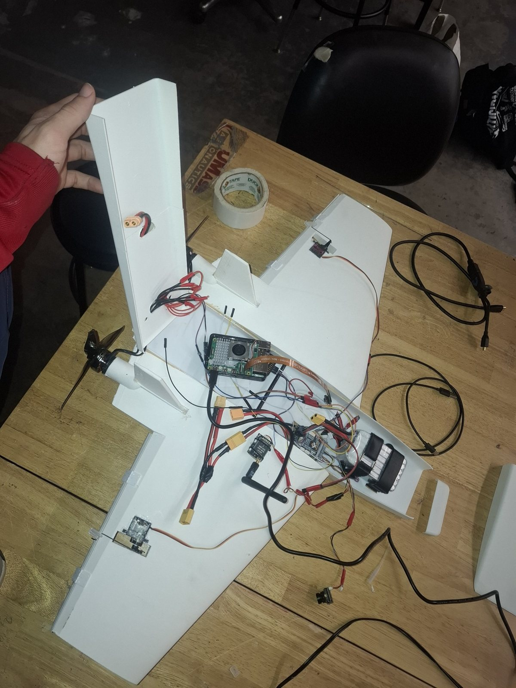
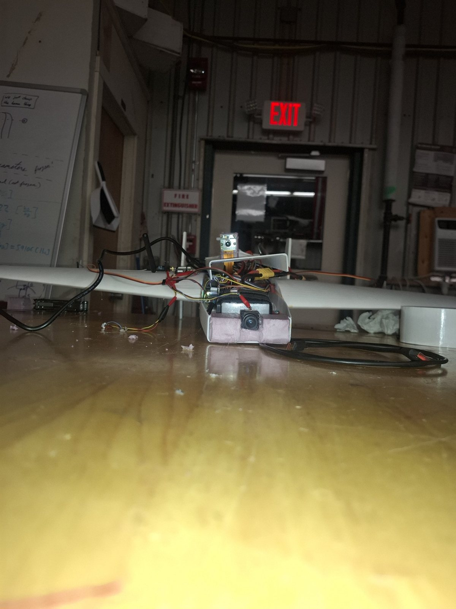
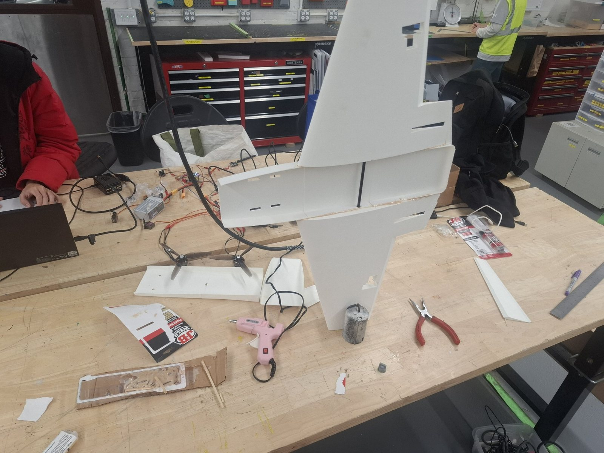
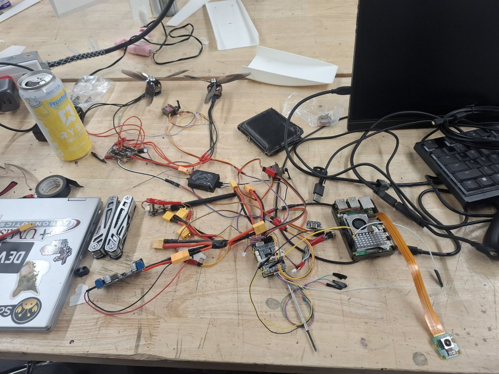
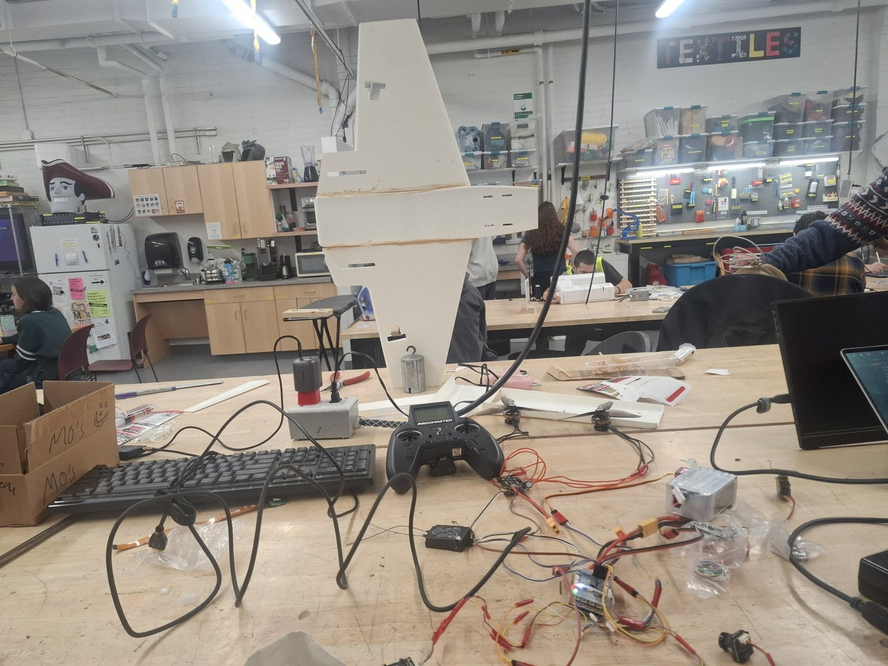

# AWRAS 1.3

**Printed in one go on a K2 Plus, given a Raspberry Pi 5, and taken unassembled to HackUMass XIV, where it was turned into an autonomous balloon popper. It's still an AI UAV research plane.**


<p align="center">
  
</p>

📹 [Demo video](https://www.youtube.com/watch?v=5TatTkId2EU) · [Devpost](https://devpost.com/software/uav-balloon-popper) · [Competition repo (toyJig/UAV-Balloon-Popper)](https://github.com/toyJig/UAV-Balloon-Popper)

---

## What this is

1.3 is the rebuild after [1.2](https://github.com/morakah-hub/AWRAS-1.2) crashed on its catapult launch. The airframe is mostly the same aircraft. What's new is how it was manufactured and what's riding inside it: a Raspberry Pi 5 with a camera, so AWRAS can see and steer on its own.

Design and analysis are in [1.0](https://github.com/morakah-hub/AWRAS-1.0). The first build is [1.1](https://github.com/morakah-hub/AWRAS-1.1).

---

## What changed from 1.2

- **The wing is one piece.** I printed it on a Creality K2 Plus, so the whole wing came out in one go instead of being glued together from separate printed sections. With no joints, it's lighter, and the control-surface inaccuracies that came from lining sections up are gone.
- **3D-printed hinges instead of duct tape.** The taped control surfaces were a big part of why 1.2 crashed. The hinges are now printed parts.
- **Holes for the camera.** The airframe has openings for the Raspberry Pi Camera Module 3, which looks forward out of the nose.
- **A Raspberry Pi 5 on board.** This is the big one. The Pi runs the vision and guidance, and talks to the flight controller.

Everything else carries over from 1.2: the SpeedyBee F405 Wing running INAV, the ELRS link to a RadioMaster Zorro, and the catapult launch.

<p align="center">
  
</p>

---

## HackUMass XIV

We went to HackUMass XIV with the printed airframe still unassembled, a Raspberry Pi 5, and a camera. Over the weekend the airframe was glued and wired, the Pi went in, and we trained the detector and built the autopilot there.

The project was a two-person build with **Henry Chen ([toyJig](https://github.com/toyJig))**:

- **Henry** trained the detector, wrote the guidance code, and connected the Pi to the flight controller.
- **I** designed, built and wired the plane, and set up the link between the flight controller and the transmitter. I was with Henry while he worked on the vision side, giving suggestions, feedback and corrections.

The competition code lives in Henry's repo, [toyJig/UAV-Balloon-Popper](https://github.com/toyJig/UAV-Balloon-Popper). We both own that repo and the work on the plane. A copy is in [`autopilot/`](autopilot/) here, so this plane's repo holds everything it flies with.

### Why balloons

We needed a target for the weekend. We didn't have real drones to test against, and balloons are safe to hit, so we made it a balloon popper. The detector recognizes drones too. Balloon popping is one mission for AWRAS, but the plane is still an AI UAV research plane.

<p align="center">
  
</p>

---

## How the autopilot works

Flipping a switch on the radio hands bank and pitch to the Pi. Flipping it back gives control to the pilot.

1. **See.** The Pi reads frames from the Camera Module 3 and runs a YOLO11n detector exported to NCNN, at about 13 fps.
2. **Aim.** Each detection becomes a line-of-sight angle, with the plane's own roll and pitch (read from INAV) removed.
3. **Lead.** Proportional navigation, the same guidance idea interceptor missiles use, keeps the plane on a collision course.
4. **Stay safe.** A 15 ft altitude floor holds whenever lock-on is engaged.
5. **Steer.** The Pi writes bank and pitch targets into INAV over MSP. A chain of 14 INAV logic conditions applies them only while the lock-on switch is up, the Pi's heartbeat is fresh, and a target is locked.

Throttle stays with the pilot. Control comes back within 100 ms when the switch is flipped off, or about half a second if the Pi crashes.

Full details, wiring, INAV setup and runbooks: [`autopilot/README.md`](autopilot/README.md).

<p align="center">
  
</p>

---

## Results (bench and simulation)

| | Result |
| --- | --- |
| Drone detection | 96.6% mAP50, 97.8% precision on a held-out test set |
| Balloons against open sky | 43 of 43 found, 0 false alarms |
| Pi vs. laptop model | 392 of 392 detections matched |
| Intercept simulator | Median miss of 0.5–1.1 m on a balloon |
| Software tests | 175 passing, no hardware needed |
| Bench demo | Control surfaces followed a balloon's position in the camera view |

None of this has flown yet. These are bench, dataset and simulator numbers.

<p align="center">
  
</p>

---

## What came off the Pi

The `autopilot/` folder is Henry's repo at commit `32283fc`. I checked it against a backup taken from the plane's Pi, and the code matches. The one thing the repo didn't include is the model, so the detector that was actually deployed (`balloon_drone_v2`) is added from the Pi in [`autopilot/models/`](autopilot/models/).

---

## Repo layout

```
images/        build and bench photos
autopilot/     the HackUMass autopilot (from toyJig/UAV-Balloon-Popper)
  src/lockon/    vision, guidance, MSP link, controller
  tools/         training, export, bench tests, live preview
  tests/         175 pytest tests
  docs/          hardware runbooks and bench findings
  models/        the deployed balloon_drone_v2 detector
```

---

## Status

- [x] Wing printed in one go on the K2 Plus
- [x] 3D-printed hinges
- [x] Camera holes in the airframe
- [x] Airframe assembled and wired at HackUMass XIV
- [x] Raspberry Pi 5 and Camera Module 3 installed
- [x] Detector trained and running on the Pi
- [x] Autopilot bench tested (props off)
- [ ] Props-on integration test
- [ ] First flight
- [ ] Lock-on flight test
- [ ] Pop a balloon

---

## Links

- Demo video: [YouTube](https://www.youtube.com/watch?v=5TatTkId2EU)
- Devpost: [UAV Balloon Popper](https://devpost.com/software/uav-balloon-popper)
- Competition repo: [toyJig/UAV-Balloon-Popper](https://github.com/toyJig/UAV-Balloon-Popper)
- Earlier versions: [1.0](https://github.com/morakah-hub/AWRAS-1.0) · [1.1](https://github.com/morakah-hub/AWRAS-1.1) · [1.2](https://github.com/morakah-hub/AWRAS-1.2)

Built by Mohamed-Essadak Rakah ([morakah-hub](https://github.com/morakah-hub)) and Henry Chen ([toyJig](https://github.com/toyJig)).
